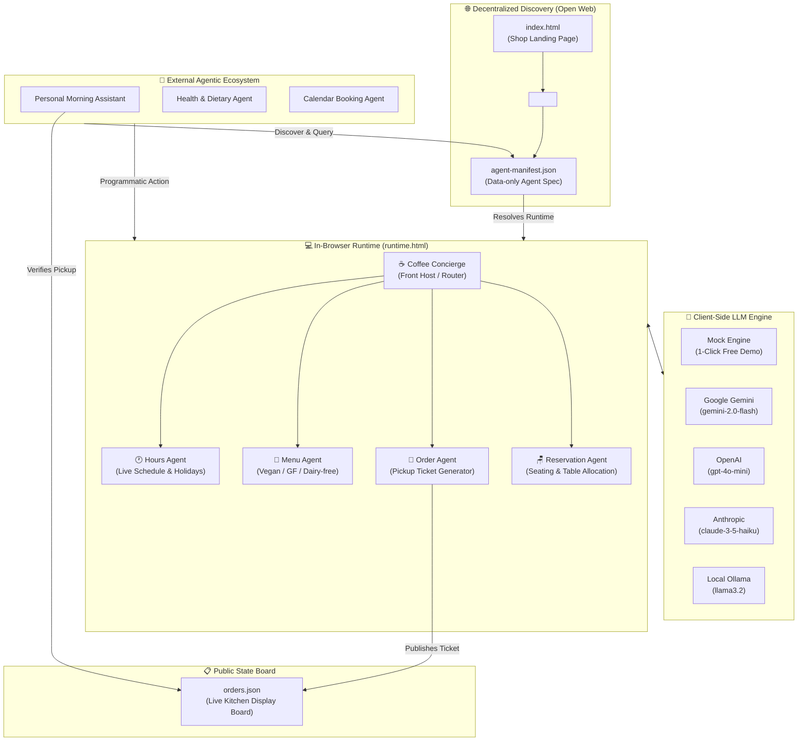

# ☕ Bean & Leaf Coffee — Open Agentic Web

> **A neighborhood coffee shop powered by an in-browser 5-agent network built for the Open Agentic Web.**  
> *Zero host cost for AI inference • Fully client-side execution • Public decentralized manifest • Interoperable state board.*

Built for the **[Open Agentic Web Challenge](https://cognizant-agenticweb.devpost.com/)**  
*Cognizant AI Lab • Mozilla Otari • MIT Media Lab NANDA • Amazon Web Services (AWS)*

---

## 🌟 Executive Summary

Small neighborhood businesses (cafés, bookshops, local diners) have traditionally been excluded from the agentic AI revolution because running cloud-hosted agent backends incurs heavy per-token API fees and server maintenance costs.

**Bean & Leaf Coffee** demonstrates how any local business can deploy a complete, autonomous multi-agent experience directly on the open web with **zero server infrastructure costs**:
1. **Data-Only Manifest (`agent-manifest.json`)**: Declares the store’s 5 agents, capabilities, schedules, menu dietary tags, and seating capacity in open, standard JSON.
2. **Client-Side Execution (`runtime.html`)**: The multi-agent runtime executes entirely inside the visitor’s browser sandbox using standard web technologies (HTML, CSS, JavaScript).
3. **Bring Your Own Key (BYOK)**: Customers bring their own LLM key (Google Gemini, OpenAI, Anthropic, local Ollama, or an instant zero-key Mock engine). The shop pays **$0** for AI inference.
4. **Open Interoperability & State Board (`orders.json`)**: Incoming pickup tickets and reservations are written to a public, verifiable order board—allowing external personal agents (like an autonomous morning routine assistant or delivery aggregator) to discover, query, and transact across origins.

---

## 🏗️ System Architecture



---

## 🤖 The 5-Agent Network

| Agent Name | Role | Primary Capabilities | Conforming Data Payload |
| :--- | :--- | :--- | :--- |
| **Coffee Concierge** | `front_man` | Intent routing, general shop guidance, agent coordination | Dynamic route map to specialist agents |
| **Hours Agent** | `specialist` | Live open status, schedule checks, holiday calendar | Weekly open/close matrix & holiday date list |
| **Menu Agent** | `specialist` | Dietary filters (vegan, gluten-free, dairy-free), pricing | Item array with dietary tags and ingredient descriptions |
| **Order Agent** | `transactional` | Total calculation, pickup ticket generation, board publish | Dynamic ticket builder & `orders.json` sink |
| **Reservation Agent** | `transactional` | Table allocation, party size validation, patio bookings | Seating layout (24 seats across 6 tables) |

---

## 🎯 Alignment with the Open Agentic Web Specification

This project strictly adheres to the **Worldwide Agentic Web MVP Specification** (`worldwide_agentic_web_mvp_spec.md`) curated by Cognizant AI Lab and partners:

1. **Standard Manifest (`agent-manifest.json`)**:
   - Tagged in `index.html` with `<link rel="agent-manifest" type="application/json" href="agent-manifest.json">`.
   - Conforms to standard fields: `name`, `version`, `spec_version`, `front_man`, `runtime`, `orderBoardUrl`, `allowed_peers`, and `agents`.
2. **Sandboxed Privacy**:
   - API keys and prompts remain in browser memory; no backend server ever intercepts credentials.
   - Includes Anthropic's direct browser access headers and CORS-safe fetch pipelines.
3. **State Transparency & Kitchen Display (KDS)**:
   - Includes a visual, real-time **Kitchen Display System** view of `orders.json` supporting both customer orders and agent-placed tickets.
4. **Cross-Site Agent Interop Simulator**:
   - Features a built-in simulation suite demonstrating how external autonomous agents handshake, query manifests, and execute transactions without humans in the loop.

---

## 🧪 Testing Guide for Judges

### Option 1: Instant 1-Click Demo (Zero Setup / No API Key Needed)
1. Open `index.html` in any modern web browser or start a local static server:
   ```bash
   npx serve .
   # or: python -m http.server 8000
   ```
2. Click **"Launch Agent Chat & Runtime"** (or open `runtime.html`).
3. The LLM provider defaults to **Mock (Free 1-Click Demo)**.
4. Try these test queries on the agents:
   - **Coffee Concierge**: *"Are you open today and what are your gluten-free bakery items?"* (Notice intent routing).
   - **Hours Agent**: Click prompt chip *"Are you open right now?"* (Calculates live status against current day).
   - **Menu Agent**: Click prompt chip *"What items are vegan?"* (Filters out non-vegan items and lists oat milk latte & dark chocolate cookies).
   - **Order Agent**: *"Order an Oat Milk Latte and Blueberry Muffin"* (Generates pickup ticket #XXXX with formatted receipt).
   - **Reservation Agent**: *"Can I reserve a patio table for 4 guests?"* (Validates capacity and books patio table t5).

### Option 2: Live Order Board & Kitchen Display System
1. In `runtime.html`, click the **"📋 Live Order Board"** tab in the top navigation bar.
2. Observe all incoming tickets in real-time. Notice how newly placed orders from your chat immediately appear on the board with `brewing` status.
3. Click **"Export JSON"** to inspect the live state payload.

### Option 3: Cross-Site Agent Interop Simulation
1. Click the **"🌐 Cross-Site Agent Interop"** tab in `runtime.html`.
2. Click **"Run Simulation →"** on any of the 3 scenarios:
   - **Scenario 1**: Autonomous Morning Routine Assistant placing an automatic breakfast order.
   - **Scenario 2**: Dietary Assistant filtering 100% certified vegan/gluten-free items.
   - **Scenario 3**: Executive Meeting Calendar Agent booking patio seating.
3. Watch the real-time protocol handshake log verify the manifest, discover the agents, execute the request, and update the public board.

### Option 4: BYOK Testing with Real LLM Keys
- Switch the **Provider** dropdown to:
  - **Google Gemini**: Enter your free Gemini API key (runs `gemini-2.0-flash`).
  - **OpenAI**: Enter your OpenAI key (runs `gpt-4o-mini`).
  - **Anthropic**: Enter your Anthropic key (runs `claude-3-5-haiku`).
  - **Ollama**: Connect to your local `http://localhost:11434` instance.
- Click **"Connect Key"** and chat with any agent with real generative reasoning.

---

## 🎬 3-Minute Video Presentation Script

*Use this script for the required Devpost video submission:*

- **[0:00 - 0:45] The Problem & The Vision**:
  - *"Hello! Welcome to Bean & Leaf Coffee. In today's web, deploying autonomous AI agents usually requires complex backends, cloud databases, and steep per-token API bills that small businesses can't afford."*
  - *"With the Open Agentic Web specification, we’ve flipped this model on its head. Bean & Leaf is a neighborhood coffee shop running a 5-agent network entirely in the user’s browser—costing the shop exactly zero dollars in hosting and inference."*
- **[0:45 - 1:40] Manifest & The 5-Agent Roster**:
  - *Show `agent-manifest.json` on the landing page.*
  - *"Our website exposes a standard `agent-manifest.json`. Any browser or external agent can discover our Coffee Concierge, Hours Agent, Menu Agent with vegan and gluten-free filters, Order Agent, and Reservation Agent."*
  - *Open `runtime.html`.*
  - *"Users bring their own model—Gemini, OpenAI, Anthropic, Ollama, or our instant zero-setup Mock engine. Watch as I ask for gluten-free options and place an order for an Oat Milk Latte. Notice how the Order Agent calculates the total and issues a verified digital pickup ticket."*
- **[1:40 - 2:25] The Public State Board & Kitchen Display**:
  - *Switch to the "Live Order Board" tab.*
  - *"Here is our public state board (`orders.json`). The order we just placed is immediately live on the kitchen display system, ready for the barista to brew. Both humans and autonomous bots share this same open board."*
- **[2:25 - 3:00] Cross-Site Agent Interoperability & Conclusion**:
  - *Switch to the "Cross-Site Agent Interop" tab and click "Run Simulation".*
  - *"Finally, the real power of the Open Agentic Web: cross-site agent orchestration. Watch an external personal assistant agent discover our manifest over HTTP, negotiate with our Order Agent, and autonomously secure a breakfast order without a human touching a button."*
  - *"Bean & Leaf Coffee proves that the Open Agentic Web is open, secure, cost-free for small businesses, and ready today. Thank you!"*

---

## 📁 Repository File Map

```
├── agent-manifest.json  # Canonical Open Agentic Web manifest (spec-compliant)
├── agent-network.json   # Secondary network mirror for backward compatibility
├── index.html           # Public storefront with <link rel="agent-manifest">
├── runtime.html         # Multi-agent in-browser runtime, KDS board, & interop simulator
├── orders.json          # Public order board state
└── README.md            # Complete architecture & judging guide
```

---

## 🏆 Credits & Open Source

- **Challenge**: [Open Agentic Web Challenge on Devpost](https://cognizant-agenticweb.devpost.com/)
- **Organizers**: Cognizant AI Lab, Mozilla Otari, MIT Media Lab NANDA, AWS
- **License**: MIT Open Source
